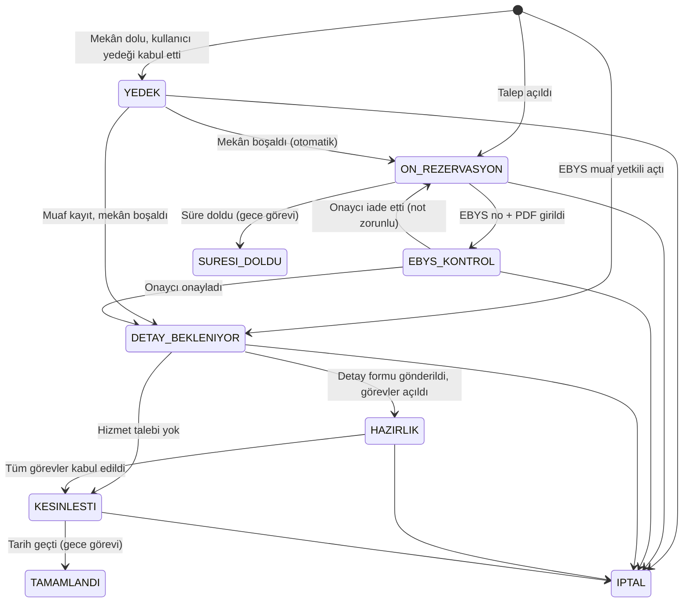

# İş akışı ve durumlar

Durumlar ve izin verilen geçişler `sunucu/logic.js` içindeki `DURUM` ve `GECISLER` sabitlerindedir. Bu doküman onların açıklamasıdır; kod ile çelişirse kod esastır ve bu dosya güncellenmelidir.

## Durumlar

| Kod | Ekranda | Mekânı tutar mı? | Kim ilerletir |
| --- | --- | --- | --- |
| `YEDEK` | Yedek sırada | Hayır | Sistem (mekân boşalınca) |
| `ON_REZERVASYON` | Ön rezervasyon | Evet | Talep eden (EBYS no girer) |
| `EBYS_KONTROL` | EBYS kontrolünde | Evet | Birim onaycısı |
| `DETAY_BEKLENIYOR` | Detay formu bekleniyor | Evet | Talep eden |
| `HAZIRLIK` | Hazırlık | Evet | Hizmet birimleri |
| `KESINLESTI` | Kesinleşti | Evet | Sistem (tarih geçince) |
| `TAMAMLANDI` | Tamamlandı | Hayır | — |
| `IPTAL` | İptal | Hayır | — |
| `SURESI_DOLDU` | Süresi doldu | Hayır | — |

"Mekânı tutar" durumları `AKTIF_DURUMLAR` listesidir; çakışma kontrolü yalnızca bunlara bakar.

## Görev durumları (hizmet birimleri)

`BEKLIYOR` → `KABUL` / `BILGI_ISTENDI` / `RED` → `TAMAMLANDI`

`RED` ve `BILGI_ISTENDI` için not zorunludur ve talep edene e-posta gider. Etkinlik, tüm görevleri `KABUL` veya `TAMAMLANDI` olunca kesinleşir.

## Gece görevi (`gunlukSureKontrolu`, her gün 02:00; Vercel Cron)

1. Bitişi geçmiş ön rezervasyonları `SURESI_DOLDU` yapar, sahibine bildirir, sıradaki yedeği terfi ettirir.
2. Bitişine `HATIRLATMA_GUN` iş günü kalanlara hatırlatma gönderir.
3. Tarihi geçmiş `KESINLESTI` etkinlikleri `TAMAMLANDI` yapar.

## Elle durum değişikliği

Yönetici, Yönetim sekmesinden yalnızca `GECISLER`'de izin verilen bir geçişi açıklama yazarak yapabilir. Yedekteki bir kaydı öne almak çifte rezervasyona yol açabilir; önce çakışan kaydı iptal etmek gerekir.
